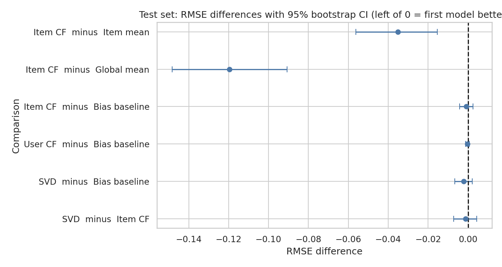
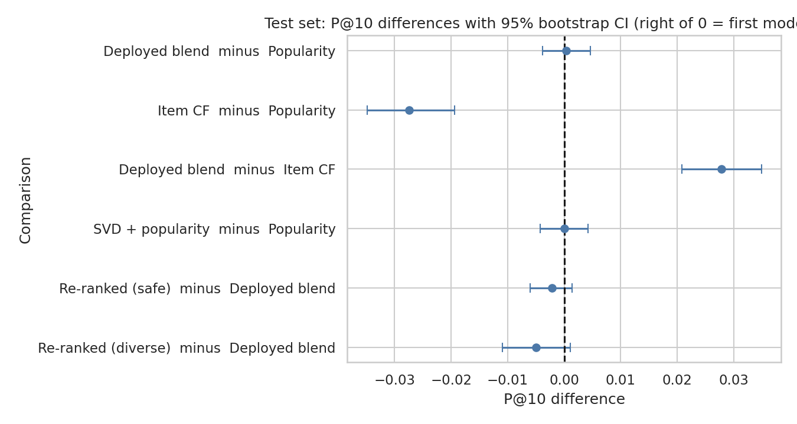
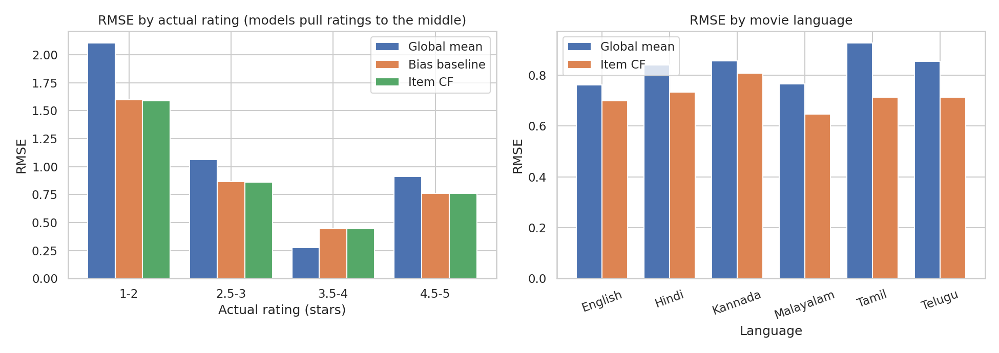
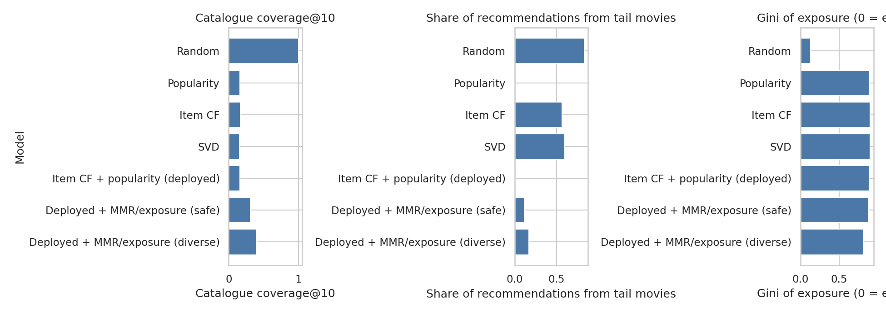
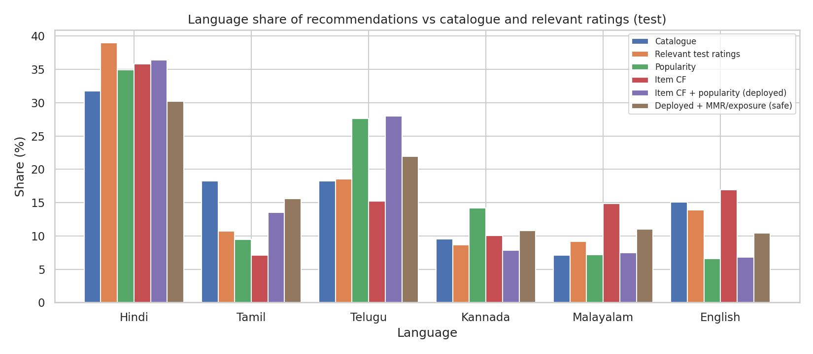
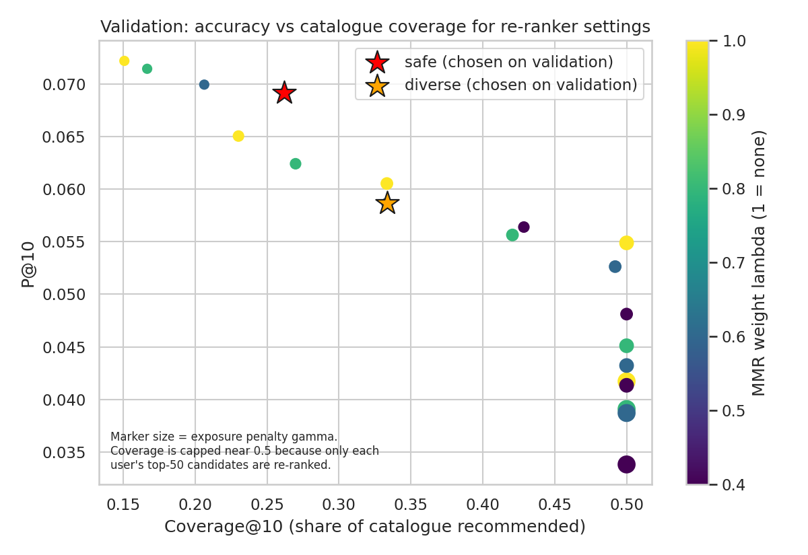
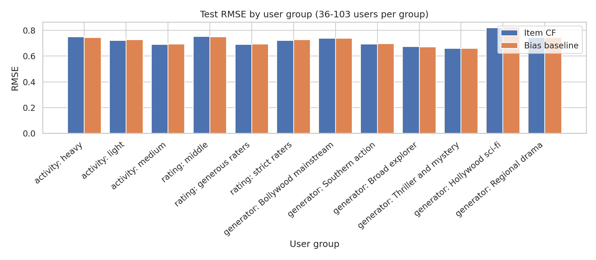

# Stage 10: Evaluation, validation and audit (auto-generated by src/make_report_stage10.py)

## 1. Protocol (fixed before the test set was opened)
- Train on train_full (4,029 ratings); score the locked test set (971 ratings, 284 users with at least one relevant movie). Test SHA-256 verified; results/test_opened.txt records the single run.
- Deployed model (declared in Stage 9): item-based CF + popularity blend. Re-ranker settings ("safe", "diverse") were chosen on VALIDATION by a stated rule. Nothing was reselected after seeing test results.
- Relevance for ranking: rating >= 4.0; unrated movies count as non-relevant (pessimistic). Candidates exclude movies the user already rated in training.
- Uncertainty: paired bootstrap over users (2,000 resamples, seed 42).
- Caveat: 13% of test ratings come from the provided original file and carry no taste signal (RMSE 0.918 vs 0.687 on generated rows). Tables also show results without them.

## 2. Headline results

### Rating prediction

| model         |   RMSE |    MAE |   RMSE excl. original rows |
|:--------------|-------:|-------:|---------------------------:|
| Global mean   | 0.8420 | 0.6958 |                     0.8404 |
| User mean     | 0.8248 | 0.6697 |                     0.8066 |
| Item mean     | 0.7576 | 0.6094 |                     0.7370 |
| Bias baseline | 0.7234 | 0.5719 |                     0.6883 |
| Item CF       | 0.7224 | 0.5705 |                     0.6872 |
| User CF       | 0.7230 | 0.5716 |                     0.6879 |
| SVD           | 0.7212 | 0.5700 |                     0.6860 |

### Top-10 ranking

| model                             |    P@5 |   P@10 |   R@10 |   NDCG@10 |   Hit@10 |   Coverage@10 |   P@10 excl. original rows |
|:----------------------------------|-------:|-------:|-------:|----------:|---------:|--------------:|---------------------------:|
| Random                            | 0.0170 | 0.0173 | 0.0848 |    0.0472 |   0.1651 |        1.0000 |                     0.0161 |
| Popularity                        | 0.1099 | 0.0792 | 0.4014 |    0.2944 |   0.6444 |        0.1587 |                     0.0681 |
| Top-rated                         | 0.0768 | 0.0560 | 0.2682 |    0.1918 |   0.4718 |        0.1270 |                     0.0589 |
| Item CF                           | 0.0690 | 0.0518 | 0.2500 |    0.1760 |   0.4472 |        0.1667 |                     0.0544 |
| User CF                           | 0.0711 | 0.0532 | 0.2541 |    0.1723 |   0.4577 |        0.1270 |                     0.0559 |
| SVD                               | 0.0718 | 0.0500 | 0.2388 |    0.1599 |   0.4225 |        0.1508 |                     0.0526 |
| Item CF + popularity (deployed)   | 0.1155 | 0.0796 | 0.4029 |    0.2864 |   0.6479 |        0.1587 |                     0.0744 |
| SVD + popularity                  | 0.1113 | 0.0792 | 0.4032 |    0.2877 |   0.6408 |        0.1667 |                     0.0744 |
| Deployed + MMR/exposure (safe)    | 0.1042 | 0.0775 | 0.3961 |    0.2846 |   0.6373 |        0.3095 |                     0.0770 |
| Deployed + MMR/exposure (diverse) | 0.1042 | 0.0746 | 0.3885 |    0.2815 |   0.6303 |        0.3968 |                     0.0722 |

(Coverage@10 here is over all users. Random is the mean of 50 seeds.)

## 3. Is the difference real? (paired bootstrap over users, 95% CI)

| comparison                                                          | metric                               |   estimate |   ci_low |   ci_high |
|:--------------------------------------------------------------------|:-------------------------------------|-----------:|---------:|----------:|
| Item CF - Item mean                                                 | RMSE (negative = first is better)    |    -0.0352 |  -0.0562 |   -0.0154 |
| Item CF - Global mean                                               | RMSE (negative = first is better)    |    -0.1195 |  -0.1483 |   -0.0908 |
| Item CF - Bias baseline                                             | RMSE (negative = first is better)    |    -0.0009 |  -0.0043 |    0.0025 |
| User CF - Bias baseline                                             | RMSE (negative = first is better)    |    -0.0003 |  -0.0013 |    0.0006 |
| SVD - Bias baseline                                                 | RMSE (negative = first is better)    |    -0.0022 |  -0.0066 |    0.0021 |
| SVD - Item CF                                                       | RMSE (negative = first is better)    |    -0.0012 |  -0.0071 |    0.0044 |
| Item CF + popularity (deployed) - Popularity                        | P@10 (positive = first is better)    |     0.0004 |  -0.0039 |    0.0046 |
| Item CF + popularity (deployed) - Popularity                        | NDCG@10 (positive = first is better) |    -0.0081 |  -0.0255 |    0.0099 |
| Item CF - Popularity                                                | P@10 (positive = first is better)    |    -0.0275 |  -0.0349 |   -0.0194 |
| Item CF - Popularity                                                | NDCG@10 (positive = first is better) |    -0.1184 |  -0.1530 |   -0.0853 |
| Item CF + popularity (deployed) - Item CF                           | P@10 (positive = first is better)    |     0.0278 |   0.0208 |    0.0349 |
| Item CF + popularity (deployed) - Item CF                           | NDCG@10 (positive = first is better) |     0.1104 |   0.0867 |    0.1344 |
| SVD + popularity - Popularity                                       | P@10 (positive = first is better)    |    -0.0000 |  -0.0042 |    0.0042 |
| SVD + popularity - Popularity                                       | NDCG@10 (positive = first is better) |    -0.0068 |  -0.0245 |    0.0116 |
| Deployed + MMR/exposure (safe) - Item CF + popularity (deployed)    | P@10 (positive = first is better)    |    -0.0021 |  -0.0060 |    0.0014 |
| Deployed + MMR/exposure (safe) - Item CF + popularity (deployed)    | NDCG@10 (positive = first is better) |    -0.0017 |  -0.0115 |    0.0073 |
| Deployed + MMR/exposure (diverse) - Item CF + popularity (deployed) | P@10 (positive = first is better)    |    -0.0049 |  -0.0109 |    0.0011 |
| Deployed + MMR/exposure (diverse) - Item CF + popularity (deployed) | NDCG@10 (positive = first is better) |    -0.0048 |  -0.0215 |    0.0115 |

**Reading:**
- CF beats the item-mean and global-mean baselines clearly (-0.035 and -0.120 RMSE) but is indistinguishable from "global mean + user bias + movie bias" (-0.0009, CI [-0.0043, +0.0025]). Matrix factorisation is nominally best (0.7212) but not significantly. Most of the accuracy comes from knowing which movies are generally liked and which users rate generously.
- Pure CF ranking is significantly WORSE than popularity (P@10 -0.0275). The CF + popularity blend ties popularity (+0.0004, CI [-0.0039, +0.0046]) and is significantly better than pure CF (+0.0278).
- On validation the blend had looked clearly better than popularity (P@10 +0.0135, 95% CI [+0.0079, +0.0192]). On test that advantage disappeared. The blend weight was chosen on the same data, so the validation result was optimistic: a concrete example of selection bias, and the reason the test set was kept sealed.
- Plausible reason popularity is hard to beat here: in the synthetic data users rate popular movies more often, so popularity predicts which movies get rated later, which is what the ranking test measures.

## 4. Stage 1 success criteria

|   # | Criterion (Stage 1)                                      | Target                  | Result on test set                                                | Met?                                          |
|----:|:---------------------------------------------------------|:------------------------|:------------------------------------------------------------------|:----------------------------------------------|
|   1 | Best CF RMSE below item-mean baseline                    | Lower                   | 0.7224 vs 0.7576 (diff -0.0352, CI [-0.0562, -0.0154])            | Met                                           |
|   2 | Best CF RMSE below global-mean baseline                  | Lower                   | 0.7224 vs 0.8420 (diff -0.1195, CI [-0.1483, -0.0908])            | Met                                           |
|   3 | P@10 above popularity baseline                           | Higher                  | 0.0796 vs 0.0792 (diff +0.0004, CI [-0.0039, +0.0046])            | Not met (statistical tie)                     |
|   4 | Catalogue coverage@10                                    | >= 30% (assumed target) | deployed 15.9%; with safe re-ranker 31.0%; diverse 39.7%          | Not met by deployed model; met with re-ranker |
|   5 | Re-ranker raises diversity with <= 5% relative P@10 loss | Improves, loss <= 5%    | combined ILD 0.818 -> 0.869; P@10 0.0796 -> 0.0775 (-2.7%)        | Met                                           |
|   6 | RMSE gap across user-activity groups                     | <= 0.15                 | 0.057 (bootstrap 95% range 0.016-0.138; max-min is biased upward) | Met                                           |
|   7 | API and UI                                               | All endpoint tests pass | Built in Stage 11                                                 | Pending                                       |

## 5. Error analysis (deployed rating model = item-based CF)

| by            | group          |   n |   RMSE_item_cf |   RMSE_bias |   RMSE_global_mean |   mean_error |
|:--------------|:---------------|----:|---------------:|------------:|-------------------:|-------------:|
| language      | English        | 127 |          0.700 |       0.697 |              0.762 |       -0.104 |
| language      | Hindi          | 342 |          0.735 |       0.734 |              0.840 |       -0.043 |
| language      | Kannada        |  86 |          0.809 |       0.815 |              0.857 |        0.000 |
| language      | Malayalam      |  87 |          0.647 |       0.647 |              0.767 |        0.037 |
| language      | Tamil          | 143 |          0.714 |       0.718 |              0.928 |        0.107 |
| language      | Telugu         | 186 |          0.713 |       0.715 |              0.854 |       -0.061 |
| genre         | Action         | 204 |          0.748 |       0.751 |              0.915 |        0.007 |
| genre         | Comedy         | 156 |          0.698 |       0.697 |              0.736 |       -0.122 |
| genre         | Drama          | 162 |          0.758 |       0.754 |              0.902 |        0.101 |
| genre         | Romance        | 167 |          0.672 |       0.679 |              0.828 |       -0.071 |
| genre         | Sci-Fi         |  88 |          0.679 |       0.685 |              0.804 |       -0.170 |
| genre         | Thriller       | 194 |          0.744 |       0.742 |              0.818 |        0.039 |
| pop_tercile   | rare movies    | 324 |          0.734 |       0.734 |              0.878 |        0.014 |
| pop_tercile   | mid            | 323 |          0.765 |       0.766 |              0.806 |       -0.054 |
| pop_tercile   | popular movies | 324 |          0.664 |       0.666 |              0.841 |       -0.024 |
| activity      | heavy          | 353 |          0.749 |       0.745 |              0.832 |       -0.080 |
| activity      | light          | 309 |          0.721 |       0.728 |              0.844 |        0.026 |
| activity      | medium         | 309 |          0.692 |       0.693 |              0.851 |       -0.001 |
| rating_bucket | 1-2            |  31 |          1.586 |       1.595 |              2.107 |        1.506 |
| rating_bucket | 2.5-3          | 191 |          0.860 |       0.863 |              1.064 |        0.739 |
| rating_bucket | 3.5-4          | 381 |          0.443 |       0.442 |              0.277 |        0.023 |
| rating_bucket | 4.5-5          | 368 |          0.760 |       0.759 |              0.911 |       -0.590 |
| era           | before 2010    | 225 |          0.712 |       0.711 |              0.865 |       -0.107 |
| era           | 2010-2017      | 357 |          0.731 |       0.731 |              0.863 |        0.022 |
| era           | 2018 or later  | 389 |          0.721 |       0.723 |              0.808 |       -0.011 |
| is_original   | False          | 841 |          0.687 |       0.688 |              0.840 |       -0.011 |
| is_original   | True           | 130 |          0.918 |       0.919 |              0.852 |       -0.087 |

- Predictions are pulled towards the middle: movies actually rated 1-2 stars are predicted +1.51 stars too high and movies rated 4.5-5 are predicted -0.59 too low. Typical of rating models with noisy data.
- Errors are similar across languages, genres, eras and activity levels; rare movies are harder than popular ones (0.734 vs 0.664).
- Group differences of a few hundredths of RMSE are within noise at these sample sizes (about 90-340 ratings per group).

### Calibration (predicted vs actual rating)

| pred_bin   |   n |   mean_predicted |   mean_actual |
|:-----------|----:|-----------------:|--------------:|
| <3.0       |  34 |            2.786 |         2.706 |
| 3.0-3.5    | 186 |            3.301 |         3.478 |
| 3.5-4.0    | 364 |            3.758 |         3.806 |
| 4.0-4.5    | 263 |            4.225 |         4.137 |
| 4.5+       | 124 |            4.734 |         4.702 |

## 6. What drives the model (explainability)
- Ablation: global mean 0.842 -> + movie effect 0.758 -> + user effect 0.723 -> + CF neighbours 0.722. Nearly all accuracy is in the biases.
- Most positive and negative movie biases (deployed model, trained on train_full):

| movie_id   |   movie_bias | movie                       |
|:-----------|-------------:|:----------------------------|
| M030       |       -1.043 | Sholay                      |
| M006       |       -0.989 | Lagaan                      |
| M115       |       -0.971 | Gladiator                   |
| M057       |       -0.912 | Minnale                     |
| M072       |       -0.869 | Dear Comrade                |
| M083       |        0.652 | Agent Sai Srinivasa Athreya |
| M021       |        0.668 | A Wednesday                 |
| M012       |        0.699 | Barfi!                      |
| M031       |        0.720 | Dhoom 2                     |
| M067       |        0.774 | Magadheera                  |

- SVD item factors vs genre+language: R-squared 0.092 against 0.080 for shuffled metadata (the chance level). The latent factors do not line up with genre or language, so they cannot honestly be described as genre tastes.
- Per-recommendation explanation: Recommender.explain(user, movie) returns the global mean, user bias, movie bias, CF adjustment and the rated movies that pulled the prediction most (used by the API in Stage 11).

## 7. Business-logic checks
- Hit@10 for the deployed model is 64.8% (a user gets at least one later-liked movie in the top 10) versus 16.5% for random.
- Recommended lists never contain movies the user already rated (asserted in tests/test_audit.py and tests/test_models.py).
- Unknown users receive the popularity fallback; invalid k raises an error (tests/test_models.py).
- Hidden-taste check (audit only): average alignment of recommended movies with each user's generator taste group is 0.483 for the deployed model, 0.487 for pure CF, 0.487 for popularity and 0.495 for random. **No model beats random**, so there is no evidence that the recommender recovers the built-in taste groups from this little data.

## 8. Diversity, popularity bias and fairness audit (mandatory)

| model                             |   ild_genre |   ild_language |   coverage |   gini_exposure |   tail_share_of_recs |   tail_items_recommended |   novelty_bits |   pop_exposure_spearman |   unexpected_share |   serendipity_per_list |   taste_alignment |
|:----------------------------------|------------:|---------------:|-----------:|----------------:|---------------------:|-------------------------:|---------------:|------------------------:|-------------------:|-----------------------:|------------------:|
| Random                            |       0.842 |          0.800 |      1.000 |           0.130 |                0.835 |                  101.000 |          7.436 |                  -0.358 |              0.671 |                  0.110 |             0.495 |
| Popularity                        |       0.792 |          0.816 |      0.159 |           0.888 |                0.000 |                    0.000 |          5.554 |                   0.633 |              0.614 |                  0.482 |             0.487 |
| Top-rated                         |       0.807 |          0.871 |      0.127 |           0.905 |                0.499 |                    9.000 |          6.479 |                   0.290 |              0.616 |                  0.350 |             0.481 |
| Item CF                           |       0.802 |          0.841 |      0.167 |           0.899 |                0.566 |                   14.000 |          6.646 |                   0.177 |              0.624 |                  0.327 |             0.487 |
| User CF                           |       0.811 |          0.828 |      0.127 |           0.906 |                0.558 |                    9.000 |          6.612 |                   0.238 |              0.628 |                  0.330 |             0.488 |
| SVD                               |       0.802 |          0.808 |      0.151 |           0.901 |                0.603 |                   12.000 |          6.740 |                   0.211 |              0.635 |                  0.324 |             0.481 |
| Item CF + popularity (deployed)   |       0.826 |          0.810 |      0.159 |           0.890 |                0.015 |                    3.000 |          5.609 |                   0.610 |              0.639 |                  0.502 |             0.483 |
| SVD + popularity                  |       0.823 |          0.809 |      0.167 |           0.890 |                0.016 |                    4.000 |          5.610 |                   0.613 |              0.642 |                  0.498 |             0.476 |
| Deployed + MMR/exposure (safe)    |       0.868 |          0.869 |      0.310 |           0.877 |                0.117 |                   17.000 |          5.747 |                   0.730 |              0.643 |                  0.492 |             0.490 |
| Deployed + MMR/exposure (diverse) |       0.863 |          0.847 |      0.397 |           0.814 |                0.173 |                   25.000 |          5.849 |                   0.842 |              0.628 |                  0.472 |             0.494 |

- **Popularity bias / filter bubble:** the deployed blend recommends only 3 of 101 tail movies (tail share 1.5%); catalogue coverage is 15.9% and exposure Gini 0.89. Everyone gets almost the same list. The popularity-heavy models (popularity itself and the blend) are the ones that score highest on P@10, while pure CF scores lower but is more varied, so accuracy and diversity pull in opposite directions.
- **Regional-language exposure:** Tamil, Telugu, Kannada and Malayalam are 53.2% of the catalogue and 47.1% of relevant test ratings; the deployed blend gives them 56.8% of slots and the safe re-ranker 59.4%. Within that, Telugu is over-exposed (28.0% vs 18.3% of the catalogue) and English under-exposed (6.8% vs 15.1%).

| language   |   Catalogue |   Train ratings |   Relevant test ratings |   Popularity |   Item CF |   SVD |   Item CF + popularity (deployed) |   Deployed + MMR/exposure (safe) |   Deployed + MMR/exposure (diverse) |
|:-----------|------------:|----------------:|------------------------:|-------------:|----------:|------:|----------------------------------:|---------------------------------:|------------------------------------:|
| Hindi      |        31.7 |            33.7 |                    39.0 |         35.0 |      35.8 |  40.8 |                              36.4 |                             30.2 |                                33.3 |
| Tamil      |        18.3 |            15.5 |                    10.7 |          9.5 |       7.1 |   6.6 |                              13.5 |                             15.6 |                                13.0 |
| Telugu     |        18.3 |            20.7 |                    18.5 |         27.6 |      15.2 |  15.3 |                              28.0 |                             22.0 |                                21.4 |
| Kannada    |         9.5 |             9.1 |                     8.7 |         14.2 |      10.0 |   7.2 |                               7.8 |                             10.8 |                                10.0 |
| Malayalam  |         7.1 |             7.3 |                     9.2 |          7.2 |      14.9 |  10.1 |                               7.5 |                             11.0 |                                 8.5 |
| English    |        15.1 |            13.7 |                    13.9 |          6.6 |      17.0 |  20.0 |                               6.8 |                             10.4 |                                13.8 |

### Mitigation: MMR re-ranking with an exposure penalty
- Rule (set on validation): maximise coverage@10 subject to relative P@10 loss <= 5% (safe) or <= 20% (diverse). Chosen: safe = lambda 0.4, gamma 0.0; diverse = lambda 0.6, gamma 0.5.
- Test: safe raises coverage 15.9% -> 31.0%, combined list diversity 0.818 -> 0.869, tail share 1.5% -> 11.7%, at P@10 0.0796 -> 0.0775 (CI of the difference includes 0). Diverse reaches coverage 39.7% at P@10 0.0746.
- Honest limits: coverage cannot exceed about 0.5 because only the top-50 candidates of each user are re-ranked. Relative P@10 loss was 4.2% (safe) and 18.8% (diverse) on validation versus 2.7% and 6.2% on test; small samples make both noisy. The exposure penalty depends on user processing order; a live system would use running counts.

### Group fairness (no demographic data exists: groups are activity, rating generosity and the hidden generator taste group)

| grouping                 | group                |   users |   test_ratings |   RMSE Item CF |   RMSE Bias baseline |   P@10 Item CF + popularity (deployed) |   NDCG@10 Item CF + popularity (deployed) |   P@10 Deployed + MMR/exposure (safe) |   NDCG@10 Deployed + MMR/exposure (safe) |
|:-------------------------|:---------------------|--------:|---------------:|---------------:|---------------------:|---------------------------------------:|------------------------------------------:|--------------------------------------:|-----------------------------------------:|
| activity (train ratings) | heavy                |     103 |            353 |          0.749 |                0.745 |                                  0.088 |                                     0.274 |                                 0.082 |                                    0.271 |
| activity (train ratings) | light                |     103 |            309 |          0.721 |                0.728 |                                  0.075 |                                     0.312 |                                 0.070 |                                    0.302 |
| activity (train ratings) | medium               |     103 |            309 |          0.692 |                0.693 |                                  0.076 |                                     0.272 |                                 0.080 |                                    0.281 |
| rating generosity        | middle               |     103 |            328 |          0.752 |                0.749 |                                  0.083 |                                     0.274 |                                 0.082 |                                    0.277 |
| rating generosity        | generous raters      |     103 |            320 |          0.691 |                0.693 |                                  0.083 |                                     0.288 |                                 0.080 |                                    0.280 |
| rating generosity        | strict raters        |     103 |            323 |          0.722 |                0.726 |                                  0.071 |                                     0.299 |                                 0.069 |                                    0.299 |
| generator taste group    | Bollywood mainstream |      82 |            254 |          0.737 |                0.738 |                                  0.074 |                                     0.319 |                                 0.071 |                                    0.315 |
| generator taste group    | Southern action      |      56 |            178 |          0.694 |                0.696 |                                  0.088 |                                     0.292 |                                 0.080 |                                    0.266 |
| generator taste group    | Broad explorer       |      37 |            121 |          0.673 |                0.670 |                                  0.109 |                                     0.393 |                                 0.109 |                                    0.396 |
| generator taste group    | Thriller and mystery |      45 |            141 |          0.661 |                0.661 |                                  0.080 |                                     0.240 |                                 0.080 |                                    0.242 |
| generator taste group    | Hollywood sci-fi     |      36 |            110 |          0.820 |                0.825 |                                  0.048 |                                     0.192 |                                 0.055 |                                    0.218 |
| generator taste group    | Regional drama       |      53 |            167 |          0.745 |                0.745 |                                  0.081 |                                     0.260 |                                 0.077 |                                    0.262 |

| grouping                 | model         |   RMSE gap (max-min) |   ci_low |   ci_high |
|:-------------------------|:--------------|---------------------:|---------:|----------:|
| activity (train ratings) | Item CF       |                0.057 |    0.016 |     0.138 |
| activity (train ratings) | Bias baseline |                0.052 |    0.015 |     0.133 |
| rating generosity        | Item CF       |                0.060 |    0.015 |     0.141 |
| rating generosity        | Bias baseline |                0.056 |    0.014 |     0.137 |
| generator taste group    | Item CF       |                0.159 |    0.083 |     0.319 |
| generator taste group    | Bias baseline |                0.164 |    0.088 |     0.322 |

- Activity-level gap 0.057 is under the 0.15 criterion. The taste-group gap (0.159) is about the same for the bias baseline (0.164), so it reflects group noise and sample size (36-82 users per group), not something CF introduces. The bootstrap range of a max-min gap is biased upward.
- Demographic fairness cannot be assessed: the dataset has no demographic attributes, by design.

## 9. Limitations (state these in the report)
- Synthetic data: effects were built into the generator, ratings are not real viewing behaviour, and results may not transfer.
- Sparse data (about 13 ratings per user): personalisation adds almost nothing beyond biases; the learning curve showed no growth with more data.
- Popularity confound: the ranking test rewards predicting what users will rate, not only what they will like.
- About 13% of test ratings come from the original noisy rows; test RMSE is slightly pessimistic.
- Test set is small (971 ratings, 284 scored users); confidence intervals are wide. Per-user split is not a strict global-time replay.
- Blend weight and re-ranker settings were chosen on validation; the validation-to-test drop above shows how optimistic such choices can be.
- No real demographic or user-consent data; no online A/B test.

## 10. What changed between validation and test
| Quantity | Validation | Test |
|---|---|---|
| Deployed blend P@10 minus popularity | +0.0135 (CI [+0.0079, +0.0192]) | +0.0004 (CI [-0.0039, +0.0046]) |
| Safe re-ranker coverage@10 | 26.2% | 31.0% |
| Item CF RMSE | 0.6888 | 0.7224 |